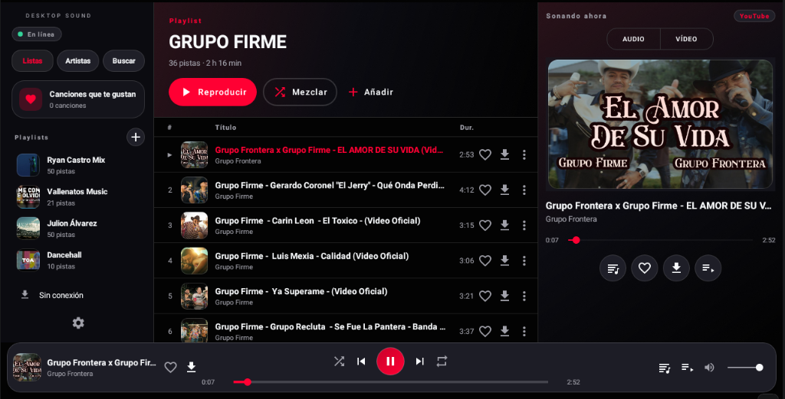
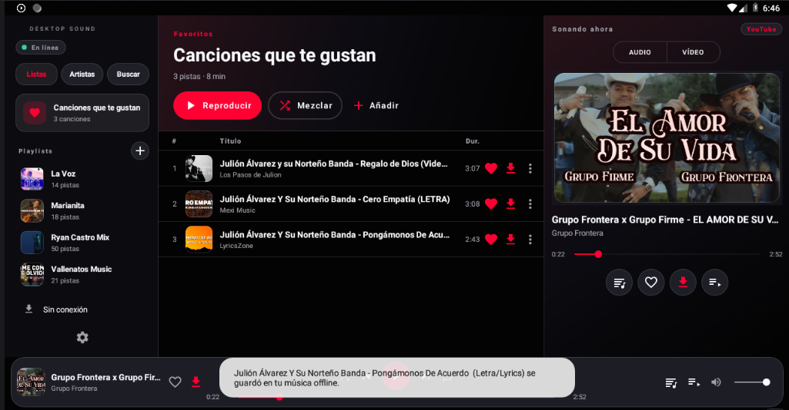
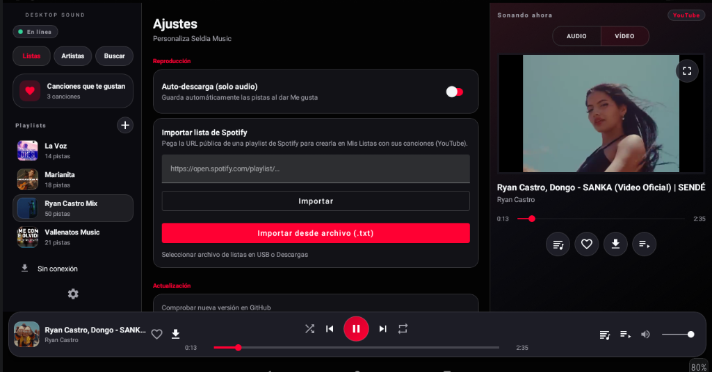

# SELDIA MUSIC

Aplicación musical completa para Android, con diseño **Dark Glassmorphism** y panel de reproductor integrado estilo "Sonando ahora", pensada para **radios Android / head units (WJ/Wonjan AC8227L, Android 8.1, 1 GB RAM, 1280×720, horizontal)** y teléfonos.

**Sin publicidad propia.** Cero SDKs publicitarios, cero banners, cero rastreadores.

---

## Capturas



| Panel completo | Descarga offline (toast) | Ajustes + vídeos |
|---|---|---|
|  |  |  |

> Tres paneles (lateral · contenido · "Sonando ahora"), filtros `Listas | Artistas | Buscar`, reproducción y barra inferior flotante. Ajustes con Spotify (URL/`.txt`), Actualización OTA, temas y acentos.

---

## Características

| Área | Estado |
|------|--------|
| **Tres paneles en horizontal** (lateral · contenido · "Sonando ahora") + barra inferior flotante, con PlayerView/ExoPlayer vinculado correctamente (sin pantalla negra en vídeo) | ✅ |
| **Logo** integrado en la cabecera (junto a "Seldia Music", card 36 dp sobre Glass) | ✅ |
| **Panel lateral:** fila de filtros `Listas \| Artistas \| Buscar`; al iniciar se selecciona la primera lista (Favoritas) en el centro; playlists **ordenadas por reproducciones** (la más escuchada primero, vía Room `COUNT(history)` + `ViewModel.sortedByDescending`); "Sin conexión" abajo, Ajustes solo icono | ✅ |
| **Búsqueda directa en YouTube vía NewPipe Extractor** (`YoutubeSearchQueryHandlerFactory.ALL`, no solo música) | ✅ |
| **Reproducción unificada Media3**: panel derecho con audio/vídeo, fullscreen con controles que se ocultan a 5 s, barra inferior clonada en fullscreen, letras en Bottom Sheet | ✅ |
| **Descargas sincronizadas en todas las vistas** (flecha en acento al descargar, también en Offline) | ✅ |
| **Sistema híbrido Online ⇄ Offline transparente y automático** (`NetworkConnectivityManager`); sin descargas de vídeo en offline (solo audio) | ✅ |
| **Listas online/offline sincronizadas con Room** (favoritos, playlists, historial y `uri` del audio descargado) | ✅ |
| **Importar listas de Spotify** (enlace público **o** archivo `.txt` línea por línea): playlists y álbumes, mapeo a YouTube/NewPipe, guardado en Room ("Mis Listas") con progreso | ✅ |
| **Copia de seguridad y restauración JSON** (SAF `CreateDocument`/`OpenDocument`) | ✅ |
| **Personalización**: Oscuro / Claro / **Glass (iPhone)** + 8 acentos dinámicos (reproducción, progreso, episodios, switches) | ✅ |
| **Rendimiento P0**: adaptadores `ListAdapter` + `DiffUtil`, Coil `size(128)` para miniaturas, scopes cancelables, `positionFlow` separado del estado discreto, release **R8 + shrinkResources** (~4 MB vs ~15 MB debug) | ✅ |
| Favoritos / Playlists / Historial (+ vaciar, renombrar, eliminar) | ✅ |
| Cola real (play, próxima/anterior, shuffle, repeat) + MediaSession + notificación | ✅ |
| Persistencia (Room + SharedPreferences) | ✅ |

---

## Requisitos de compilación

- JDK 17 (Temurin) — `JAVA_HOME` debe apuntar a un JDK 17 (el JDK del sistema puede ser más reciente y no es compatible).
- Android SDK (platform 34, build-tools), Gradle 8.9 (incluido el wrapper).

> La búsqueda YouTube funciona **sin credenciales** vía NewPipe Extractor (API Data v3 opcional vía `SELDIA_YOUTUBE_API_KEY`, no versionada).

## Compilar

```bash
# Windows
set JAVA_HOME=%USERPROFILE%\.jdks\jdk-17.0.21+9
gradlew.bat assembleDebug
gradlew.bat assembleRelease
# Linux/macOS
./gradlew assembleDebug
```

El APK debug se genera en `app/build/outputs/apk/debug/app-debug.apk` (release ofuscado en `app/build/outputs/apk/release/app-release-unsigned.apk`).

## Instalar en el dispositivo/emulador

```bash
adb install -r app/build/outputs/apk/debug/app-debug.apk
adb shell am start -n com.seldia.music/.ui.MainActivity
```

Emulador de referencia: `emulator-5554` (1280×720, API 27).

## Mínimo y objetivo

- `minSdk 27` (Android 8.1), `targetSdk 34`.
- Optimizado para 1 GB de RAM.

## Importar de Spotify

Dos métodos, ambos sin login (API Web pública, sin OAuth):

1. **Enlace**: pega `https://open.spotify.com/playlist/…` o `…/album/…` → Importar.
2. **Archivo `.txt`**: botón **"Importar desde archivo (.txt)"** ("Seleccionar archivo de listas en USB o Descargas") → un enlace por línea; respeta `?si=…`, ignora blancos, procesa secuencialmente con progreso `Procesando enlace X de N…`.

Las pistas se mapean vía NewPipe (`"$title $artist"`) y se guardan en Room para aparecer en "Mis Listas" con carátula y duraciones reales.

## Documentación

- [Arquitectura](docs/ARCHITECTURE.md)
- [Informe de pruebas](docs/TEST_REPORT.md)
- [Estado de funcionalidades](docs/FEATURES_STATUS.md)
- [Preparación para iOS](docs/IOS_PREPARATION.md)

---

## Estructura del proyecto

```
app/src/main/java/com/seldia/music/
├── SeldiaApp.kt                 # Application (+ OfflinePrefs / ThemePrefs)
├── di/AppContainer.kt           # DI manual (sin Hilt)
├── data/
│   ├── model/                   # Modelos puros Kotlin (Track, Playlist, Source)
│   ├── db/                      # Room (entidades, DAOs, Mappers; incluye markDownloaded())
│   ├── network/                 # NetworkConnectivityManager (online ⇄ offline)
│   ├── offline/                 # OfflineMusicRepository (MediaStore + descargas)
│   ├── extractor/               # YouTubeAudioExtractor (NewPipe: búsqueda ALL + streams)
│   ├── spotify/                 # Parser público (playlists + álbumes) e importador Room
│   ├── backup/                  # BackupManager JSON (SAF)
│   └── repository/              # LibraryRepository, YouTubeRepository, ...
├── playback/                    # MusicPlayer (StateFlow + positionFlow) + PlaybackService + MediaDownloadManager
└── ui/
    ├── MainActivity.kt          # Shell adaptativo (3 paneles desktop / teléfono)
    ├── adapters/                # Todo ListAdapter + DiffUtil (TrackTable, Sidebar, Playlist, HomeCard)
    ├── home/                    # HomeFragment + HomeCardAdapter
    ├── library/                 # LikedSongsFragment, PlaylistsTabFragment, MediaGroupsFragment, GroupTracksFragment, OfflineFragment, ...
    ├── settings/                # SettingsFragment (auto-descarga, Spotify URL + .txt, backup/restore, temas/acento)
    ├── search/                  # SearchFragment (NewPipe ALL)
    ├── player/                  # PlayerFragment, LyricsBottomSheetFragment, LyricsAdapter
    └── youtube/                 # YouTubePlayerActivity (IFrame API, primer plano)
buildSrc/                        # Plugin CharsetShim (compatibilidad NewPipe en API 27)
app/proguard-rules.pro           # R8: reglas Media3, Room, Coil, Rhino
```

---

## Ko-fi ☕

Si te gusta el proyecto, puedes invitarme un café o apoyar el mantenimiento:

* **Buy me a coffee (Ko-fi):** <a href="https://ko-fi.com/seldiamusic" target="_blank"></a>
* Directo: https://ko-fi.com/seldiamusic

