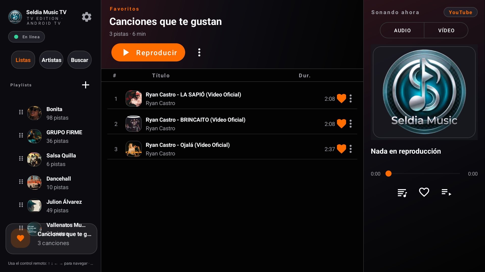
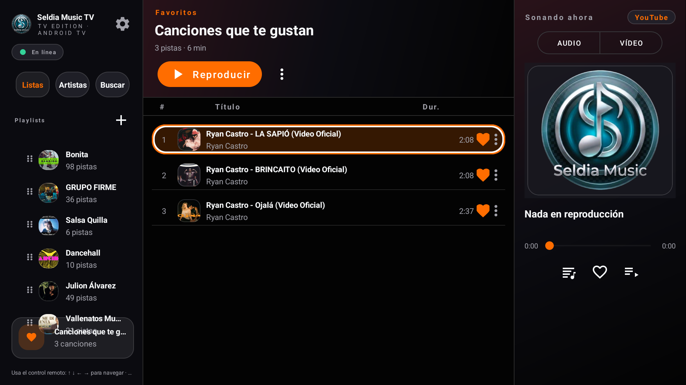
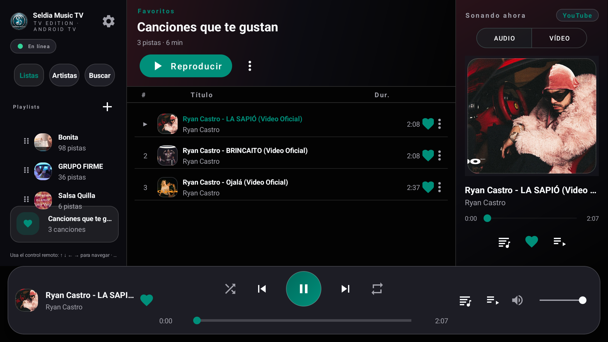
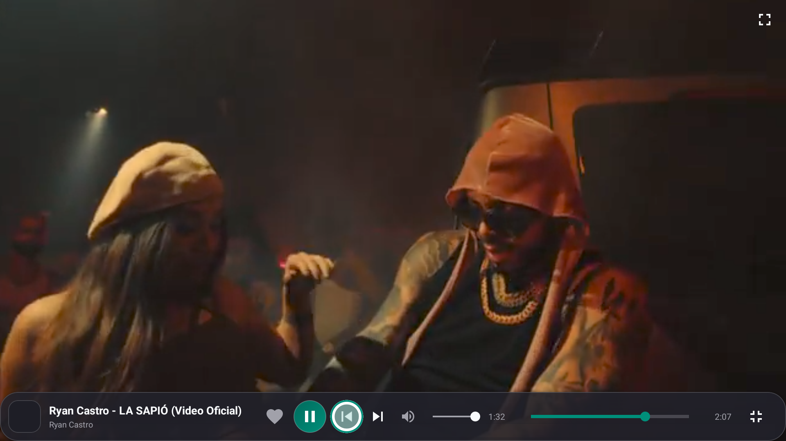
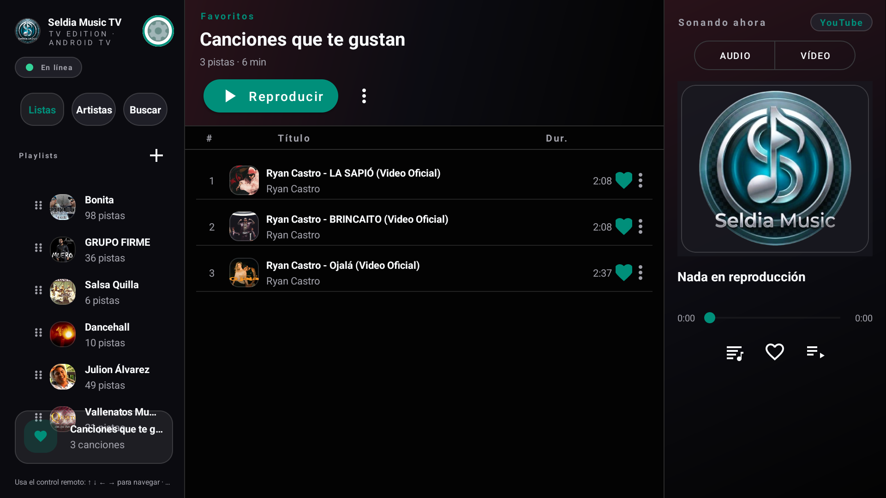

# Seldia Music TV

**El reproductor de música y video para Android TV con control remoto.**
Sidebar de navegación, tabla central de pistas y panel «Sonando ahora» en 3 columnas, foco D-pad con cristal del color de acento y pantalla completa de video navegable.



| | | |
|:---:|:---:|:---:|
|  |  |  |
| **Foco cristal del tema** en pista enfocada (naranja = acento activo) | **Video a pantalla completa** con barra flotante visible | **Navegación D-pad** en la barra: `prev → play → next → seek → minimizar` |



> Capturas reales de TV (Google TV Stick 4K + Claro STB), sin emulador.

---

## Qué es

Seldia Music TV es una alternativa ligera para televisores: accede a **millones de canciones** sin credenciales, reproduce con **Media3/ExoPlayer**, importa listas públicas (enlace o `.txt`), guarda favoritos/playlists/historial en **Room**, sincroniza letras con karaoke y se actualiza por OTA desde GitHub Releases.

**Sin publicidad propia.** Cero SDKs publicitarios, cero banners, cero rastreadores.

### Android TV / Leanback

- Nombre **Seldia Music TV**, banner y `android.software.leanback` (`required=false`, híbrido móvil/TV) con `LEANBACK_LAUNCHER` → aparece en el menú principal del TV.
- Detección `UiModeManager.TELEVISION` / `leanback` → fuerza layout de 3 paneles 10-foot (`sidebar · contenido · Sonando ahora`).
- Todo operable con **D-pad** (arriba/abajo/izquierda/derecha + Centro/Enter + Atrás): sidebar fija, barra inferior inferior con **Prev/Next de 48dp** y cadena `nextFocus` predecible, lista central que muestra 6–8 pistas sin scroll excesivo y video en pantalla completa cuyo botón **Minimizar (↘)** funciona con CENTER y con Atrás.
- **Foco cristal del tema:** borde blanco grueso + relleno del acento activo (`?attr/accentPrimary` / `accentSoft`), escala 1.06 y `foreground` con estado para contenedores; cambia al cambiar de color en Ajustes (8 acentos).

---

## Características

| Área | Estado |
|:---|:---:|
| **3 paneles en horizontal + barra inferior flotante** (video sin pantalla negra, audio/vídeo en el panel derecho) | ✅ |
| **Foco D-pad universal** (cristal del tema en cualquier control, sin recorte, sin selecciones atascadas) | ✅ |
| **Video fullscreen con barra flotante navegable** y minimizar por CENTER/Atrás | ✅ |
| Búsqueda de **millones de canciones**, sin credenciales | ✅ |
| Reproducción Media3 (cola, shuffle, repeat, MediaSession, notificación, letras) | ✅ |
| Importar listas: enlace público **o** archivo `.txt` (un enlace por línea) → Room | ✅ |
| Favoritos / Playlists / Historial (renombrar, borrar, vaciar) | ✅ |
| Copia de seguridad/restauración JSON (SAF) | ✅ |
| Temas: Oscuro / Claro / Glass + 8 acentos (todo el highlight sigue al acento) | ✅ |
| Rendimiento: `ListAdapter`+`DiffUtil`, Coil 128px, `positionFlow` separado, R8+shrinkResources | ✅ |
| Persistencia Room + SharedPreferences | ✅ |

> Sin descargas de música en TV (solo streaming); la biblioteca offline existente se sigue mostrando donde aplica.

---

## Requisitos

- **JDK 17** (Temurin) — `JAVA_HOME` a JDK 17 (el JDK del sistema puede ser más nuevo).
- Android SDK platform 34 + build-tools, Gradle 8.9 (wrapper incluido).
- TVs Android con **Depuración ADB activada** para las pruebas locales.
- Motor de búsqueda integrado, **sin credenciales**.

## Compilar

```bat
REM Windows
set JAVA_HOME=%USERPROFILE%\.jdks\jdk-17.0.21+9
gradlew.bat :app:assembleDebug
gradlew.bat :app:assembleRelease
```

```bash
# Linux / macOS
./gradlew :app:assembleDebug
```

APK debug → `app/build/outputs/apk/debug/app-debug.apk`  
Release ofuscado → `app/build/outputs/apk/release/app-release-unsigned.apk`

- `minSdk 27` (Android 8.1), `targetSdk 34`, optimizado para 1 GB de RAM.

## Arquitectura

```
app/src/main/java/com/seldia/music/
├── SeldiaApp.kt               # Application
├── di/AppContainer.kt         # DI manual (sin Hilt)
├── data/ (model, db Room, network, extractor, lists, backup, repository)
├── playback/                  # MusicPlayer StateFlow + PlaybackService
└── ui/
    ├── MainActivity.kt        # Shell 3 paneles TV + TvFocusHelper (cristal del tema)
    ├── TvFocusHelper.kt       # Foco cristal universal con estado
    ├── adapters/ home/ library/ queue/ search/ settings/ player/
    └── player/                # Pantalla completa
```

---

## Ko-fi ☕

Si te gusta el proyecto, invítame un café o apoyá el mantenimiento:

* **Buy me a coffee (Ko-fi):** <a href="https://ko-fi.com/seldiamusic" target="_blank"></a>
* Directo: https://ko-fi.com/seldiamusic
